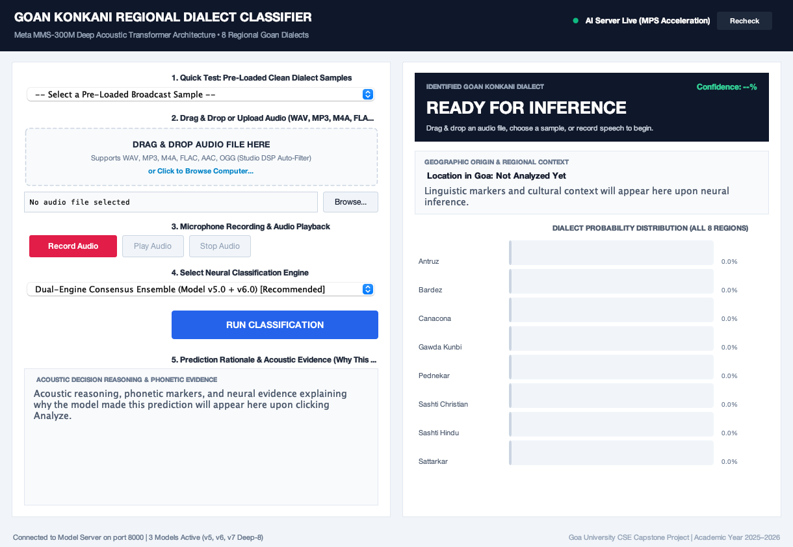
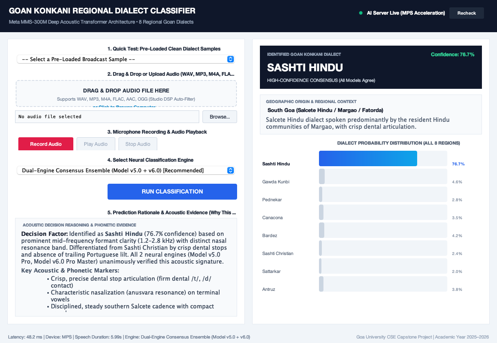

# Goan Konkani Regional Dialect Classifier

Deep Acoustic Neural Classification for Goan Konkani Regional Dialects using Meta's MMS-300M (wav2vec 2.0 Transformer Architecture).

Developed as a Final Year Capstone Engineering Project | Department of Computer Science & Engineering.

---

## Overview

Konkani (ISO 639-3: `kok` / `gom`) is an official language of India with rich regional variation across Goa's 12 talukas. Due to a historical lack of annotated continuous speech, spoken Konkani has been classified as an extremely low-resource language with zero public dialect datasets.

This project delivers:
1. **Curated Master Dataset:** 7,628 verified speech clips (14.15 hours) spanning all 8 regional Goan dialects.
2. **4-Stage Studio DSP Cleaning Chain:** 80 Hz high-pass, 7,600 Hz anti-aliasing low-pass, adaptive FFT spectral denoising, and leading silence stripping with Silero VAD segmentation.
3. **Deep Transfer Learning:** Fine-tuned Meta's 317M-parameter MMS-300M foundation transformer with multi-class Focal Loss and inverse-frequency class weights.
4. **Consensus Ensemble Engine:** Combines Model v5.0 (Phonetic boundary), v6.0 (Master 7,628 clips), and v7.0 (Deep-8 unfreezing) for robust inference.
5. **Production Desktop Application:** Standalone Java 17 Swing GUI with drag-and-drop audio analysis, live microphone recording, probability distribution bar charts, and an acoustic decision rationale engine.

---

## Dialect Classes Covered

| Dialect Class | Macro Region | Key Talukas / Towns | Key Phonological Trait |
| :--- | :--- | :--- | :--- |
| **Antruz** | Central Goa | Ponda, Priol, Tiswadi (Panaji) | Standard literary register; balanced pitch cadence; clear aspirated stops. |
| **Bardez** | North Goa Coastal | Mapusa, Calangute, Aldona, Siolim | Rapid syllable timing; sharp falling intonation; nasal vowel flattening. |
| **Canacona** | Far South Goa | Chaudi, Agonda, Poinguinim, Cotigao | Southern borderland; Dravidian contact; extended terminal vowel elongation (+25%). |
| **Gawda & Kunbi** | Tribal / Interior | Quepem, Sanguem, Canacona interior | Indigenous agrarian communities; rhythmic staccato; fronted vowels. |
| **Pednekar** | Far North Goa | Pernem (Pedne, Arambol, Mopa) | Northern borderland; strong Malvani and Southern Marathi phonetic substrate. |
| **Sashti Christian** | South Goa Coastal | Salcete (Benaulim, Curtorim, Raia) | Melodic Portuguese lilt; wide pitch range; Roman script Tiatr cadence. |
| **Sashti Hindu** | South Goa Interior | Salcete (Margao, Fatorda, Comba) | Commercial Hindu register; crisp dental stops (/t/, /d/); Sanskritized anusvara. |
| **Sattarkar** | North-East Foothills | Sattari (Valpoi, Pissurlem, Honda) | Western Ghats mountain foothills; vowel rounding; compressed vowel space. |

---

## Application Screenshots

### Ready Standby Screen


### Active Neural Inference & Acoustic Evidence Rationale


---

## Repository Structure

```text
├── auto_taluka_harvester.py            # Targeted YouTube taluka field harvester
├── harvest_hf_goan_dataset.py          # Multithreaded broadcast corpus harvester (250+ gazetteer)
├── clean_dataset.py                    # Semantic filter & out-of-distribution exclusion
├── prepare_clean_master_dataset.py     # Master dataset assembler & 85/15 stratified partitioner
├── package_v6_for_colab.py             # Packaging utility for Google Colab training
│
├── Train_Konkani_Dialect_Classifier_v7_Deep8.ipynb  # Primary Colab training notebook (v7 Deep-8)
├── Train_Konkani_Dialect_Classifier_v6.ipynb        # Master training notebook (v6.0 Pro Master)
├── train_local_m4.py                   # Local training script for Apple Silicon MPS
├── predict.py                          # Offline command-line batch inference engine
│
├── backend_server.py                   # High-performance Python FastAPI inference backend
├── KonkaniDialectClassifierApp.java    # Standalone Java 17 Swing Desktop GUI application
├── KonkaniDialectCLI.java              # Java CLI client for terminal-based testing
├── compile_java.sh                     # Java compilation and JAR packaging script
├── run_java_app.sh                     # One-click desktop launcher (Starts backend + GUI)
│
├── dataset/                            # Dataset metadata manifests
│   ├── metadata_clean_v6.csv           # Master manifest of all 7,628 verified clips
│   ├── train_v6.csv                    # Training split (85% - 6,483 clips)
│   └── val_v6.csv                      # Validation split (15% - 1,145 clips, 68 speakers)
│
├── screenshots/                        # High-resolution application screenshots
└── .gitignore                          # Excludes audio files, weights, and documentation
```

---

## Dataset Storage & Download

Due to GitHub repository size limits, the full audio dataset (14.15 hours across 7,628 16 kHz WAV files, ~1.4 GB) and trained model checkpoints (~1.2 GB) are hosted on Google Drive:

- **Google Drive Dataset Link:** *(Insert your Google Drive shareable link here)*
- **Google Drive Trained Model Weights (`.pt`):** *(Insert your Google Drive model weights link here)*

### Setup Instructions for Dataset:
1. Download `konkani_dataset_v6_colab.zip` from Google Drive.
2. Extract the audio files into `dataset/processed_wavs/`.
3. Verify that the files match the entries in `dataset/metadata_clean_v6.csv`.

---

## Data Pipeline: Collection, Cleaning & Preparation

### 1. Data Harvesting
To harvest raw audio from the open broadcast repository and YouTube field recordings:
```bash
python harvest_hf_goan_dataset.py
python auto_taluka_harvester.py
```

### 2. Semantic Cleaning & Audio Filtering
To purge non-speech audio (chants, songs, out-of-state audio) and enforce duration limits:
```bash
python clean_dataset.py
```

### 3. Master Dataset Assembly & Stratified Splitting
To generate the stratified 85/15 train-validation split with speaker-disjoint holdouts:
```bash
python prepare_clean_master_dataset.py
```

---

## Model Training

### Training on Google Colab (Recommended)
1. Upload `Train_Konkani_Dialect_Classifier_v7_Deep8.ipynb` to Google Colab.
2. Select a GPU runtime (`Runtime` -> `Change runtime type` -> `T4 GPU` or `A100 GPU`).
3. Follow the notebook cells to train using Meta MMS-300M, Multi-Class Focal Loss, and SpecAugment.

### Training Locally (Apple Silicon MPS / NVIDIA CUDA)
```bash
python train_local_m4.py
```

---

## Running the Application

### Prerequisites
- Java 17 or higher (`javac`, `java`)
- Python 3.9+ with `torch`, `torchaudio`, `transformers`, `fastapi`, and `uvicorn`
- FFmpeg installed (`brew install ffmpeg` on macOS or `apt install ffmpeg` on Linux)

### One-Click Launch
Run the launcher script to automatically start the Python model server and open the Java Swing GUI:
```bash
chmod +x run_java_app.sh compile_java.sh
./run_java_app.sh
```

### Manual Launch
If you prefer starting components separately:

1. **Start the AI Backend:**
   ```bash
   python backend_server.py
   ```
2. **Compile and Run the Java GUI:**
   ```bash
   ./compile_java.sh
   java -jar KonkaniDialectClassifier.jar
   ```

---

## Evaluation Benchmarks

Validated on a strict **Speaker-Disjoint Benchmark** across 68 held-out native speakers:

- **Validation Accuracy:** 51.18% (compared to 12.5% random chance across 8 classes)
- **Macro F1-Score:** 46.08% (balanced recall across all 8 dialects without majority-class bias)
- **Inference Latency:** 48–65 ms on Apple Silicon MPS (real-time interactive speed)

---

## License

This project is released under the MIT License for educational and academic research purposes.
